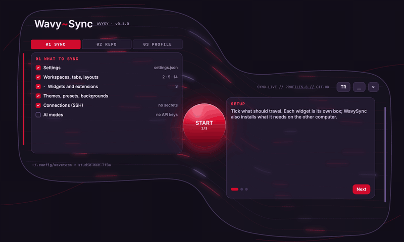
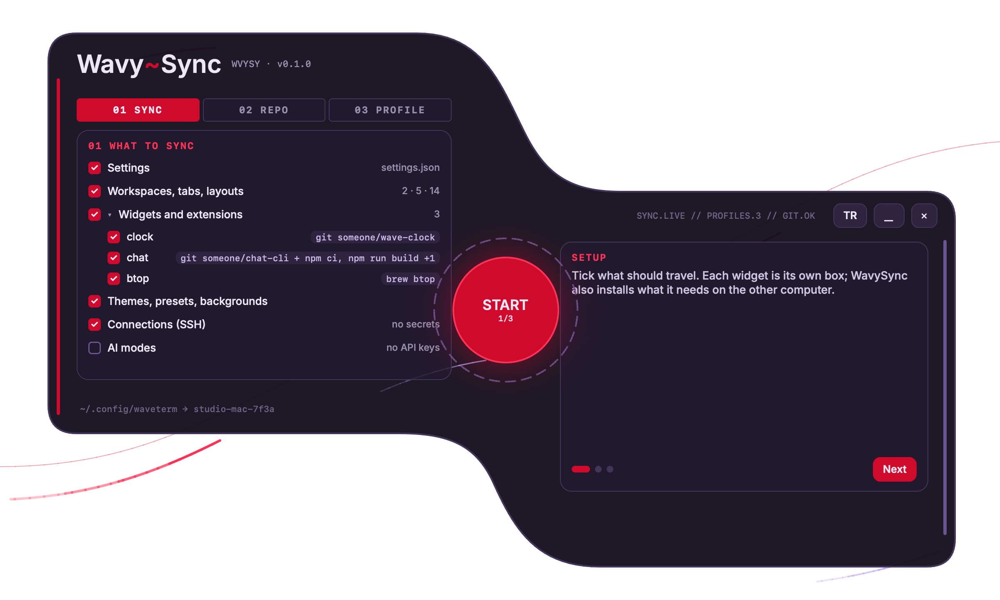
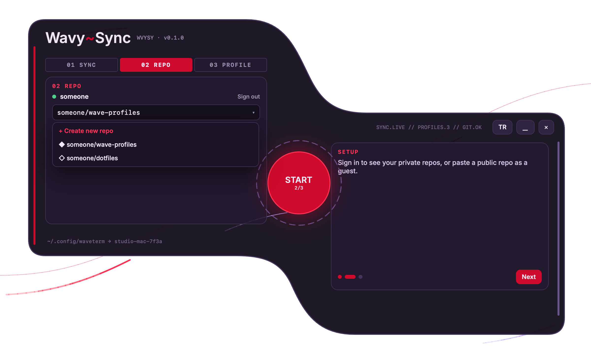
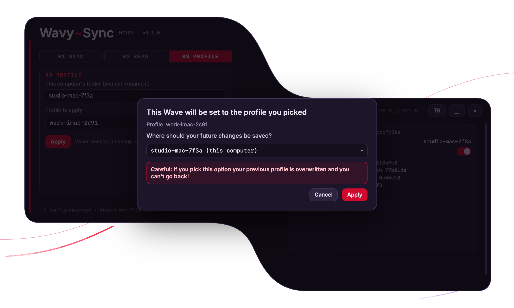
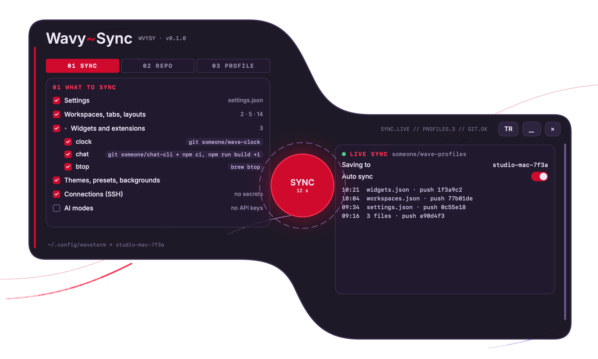

<p align="center">
  <a href="https://wavysync.vercel.app"></a>
</p>

<p align="center">
  <b>Your Wave Terminal, on every computer.</b><br>
  Settings, workspaces, tabs, layouts, widgets and the tools behind them, synced through a GitHub repo you own.
</p>

<p align="center">
  <a href="https://github.com/Ege-BULUT/WavySync/actions/workflows/ci.yml"></a>
  <a href="https://github.com/Ege-BULUT/WavySync/releases"></a>
  
  
  <a href="https://github.com/anomalyco/rune"></a>
  <a href="LICENSE"></a>
</p>

<p align="center">
  <a href="https://wavysync.vercel.app">Website</a> ·
  <a href="#install">Install</a> ·
  <a href="#how-it-works">How it works</a> ·
  <a href="#command-line">Command line</a>
</p>

<p align="center"></p>

## Why

[Wave Terminal](https://www.waveterm.dev) keeps a lot of you in it: the workspaces you arranged, the
widgets you added to the sidebar, the little web apps and CLIs those widgets open. Set up a second
computer and all of that starts from zero.

WavySync keeps one folder per computer in a GitHub repo. Every computer pushes its own Wave to its
own folder, and any computer can take on another's setup, including the tools its widgets need.

## Features

- **Everything Wave keeps.** `settings.json`, widgets, themes, presets, backgrounds, SSH
  connections, AI modes, and the workspace database: workspaces, tabs, blocks and layouts.
- **Widgets travel with what they run.** WavySync looks at each widget and finds what it needs: a git
  repo and its build steps (`npm ci`, `cargo build`, ...), a Homebrew formula, a global npm package, a
  `cargo install`, or a small script it carries along. Applying a profile installs them.
- **One folder per computer.** The folder name starts as this computer's id and you can rename it.
  Every folder shows up as a profile you can apply anywhere.
- **You choose where changes go.** Applying a profile asks where this computer's future changes
  should be saved: its own folder, the profile you just applied, or a new one.
- **Live.** A small background process pushes changes as you make them. Turn it off with one switch.
- **Private by default.** Sign in with GitHub to use a private repo. Keys, tokens and passwords are
  stripped before anything leaves your computer, and your home folder is stored as `{HOME}` so paths
  work for a different user name.
- **Guest mode.** No sign in: point it at a public repo and it pushes with this computer's own git login.
- **Native and small.** One Rust binary per platform, its window drawn with
  [Rune](https://github.com/anomalyco/rune). It also adds a WavySync widget to Wave's sidebar.

## Screens

<table>
  <tr>
    <td width="50%"></td>
    <td width="50%"></td>
  </tr>
  <tr>
    <td></td>
    <td></td>
  </tr>
</table>

## Install

Download the file for your system from [Releases](https://github.com/Ege-BULUT/WavySync/releases)
and run it. The first run opens a three step setup.

| System | File |
| --- | --- |
| macOS, Apple silicon | `wavysync-macos-arm64.tar.gz` |
| macOS, Intel | `wavysync-macos-x64.tar.gz` |
| Windows | `wavysync-windows-x64.exe` |
| Linux | `wavysync-linux-x64.tar.gz` |

The binaries are not signed. On macOS, clear the download flag once:

```sh
xattr -d com.apple.quarantine ./wavysync
```

Or build it yourself (current stable Rust; on Linux also `libxkbcommon-dev` and `libwayland-dev`):

```sh
git clone https://github.com/Ege-BULUT/WavySync
cd WavySync
cargo build --release
./target/release/wavysync
```

`git` must be on your `PATH`. Wave Terminal does not have to be installed when you apply a profile;
WavySync writes the files where Wave will read them.

## How it works

```
your-wave-profiles/                 a GitHub repo you own
├── studio-mac-7f3a/                one folder per computer
│   ├── wavysync.json               host, system, last update
│   ├── config/                     settings.json, widgets.json, themes, presets, connections
│   ├── workspaces.json             workspaces, tabs, blocks, layouts
│   ├── extensions.json             what each widget needs, and how to install it
│   └── files/                      small scripts widgets run, kept under {HOME}
├── work-imac-2c91/
└── ubuntu-lab-04be/
```

1. **Setup.** Pick what to sync, pick a repo, name this computer's folder. WavySync adds itself to
   Wave's sidebar and to your login items.
2. **Sync.** While Wave runs, the background process reads Wave's config files and its workspace
   database (read only), removes secrets and local noise, and pushes a commit when something
   changed.
3. **Apply.** Pick a profile. WavySync backs up the current Wave to `~/.config/wavysync/backups`,
   asks Wave to quit (confirm Wave's question if it shows one), writes the profile, installs what the widgets need,
   starts Wave again, and from then on pushes to the folder you chose.

What never leaves your computer: keys whose name contains `token`, `secret`, `password`, `passwd`,
`apikey`, `api_key` or `privatekey`, Wave's terminal history and scrollback, and WavySync's own
GitHub sign in, which is kept in the system keychain.

## Command line

The window covers everything, and the same actions work without it:

```
wavysync                 open the window
wavysync --sync          push now
wavysync --profiles      list the profiles in the repo
wavysync --apply NAME [--save-to FOLDER]
                         set this Wave to profile NAME
wavysync --detect        print the widgets found and what each needs
wavysync --setup REPO [--folder NAME] [--guest]
                         set up without the window
```

Settings live in `~/.config/wavysync/config.json` (`WAVYSYNC_HOME` moves them). Wave's own folders
follow `WAVETERM_CONFIG_HOME` and `WAVETERM_DATA_HOME` when they are set.

## Status

WavySync is young. Syncing and applying are tested end to end on macOS against a real Wave
Terminal. Windows and Linux builds come from CI and have seen less real use so far. Please
[open an issue](https://github.com/Ege-BULUT/WavySync/issues) when something does not come across.

## License

[MIT](LICENSE). Wave Terminal is a separate project by Command Line Inc., not affiliated with WavySync.
